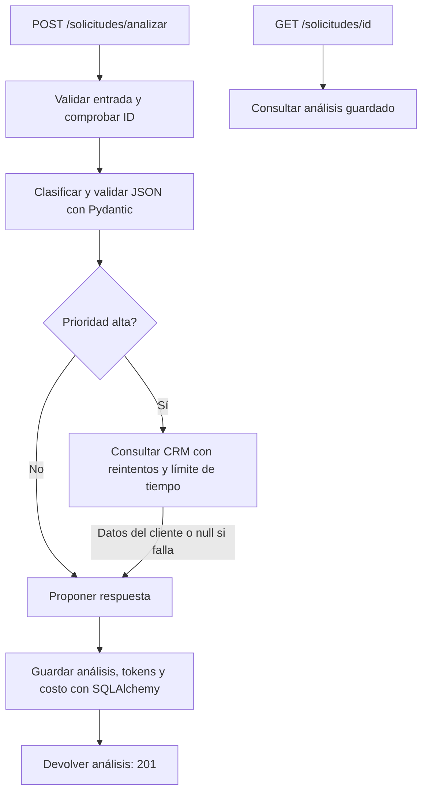

# Softgic · Análisis de solicitudes de soporte

Prueba técnica de Desarrollador Senior Full Stack: servicio que clasifica solicitudes,
consulta datos del cliente cuando la prioridad es alta, propone una respuesta y guarda
el análisis para consultarlo después.

**Python 3.11+ · FastAPI · LangGraph · Pydantic · SQLAlchemy · Angular · Docker**

> La demo funciona sin claves de IA: utiliza un modelo simulado con clasificación
> y respuesta fijas. Permite verificar el flujo y la integración, pero no evaluar
> la calidad de un modelo real.

## Entregables

| Parte | Entrega | Dónde revisarla |
| --- | --- | --- |
| 1. Servicio de análisis | API, grafo, persistencia, reintentos y pruebas | [app/](app/), [tests/](tests/), [Dockerfile](Dockerfile) |
| 2. Arquitectura en Azure | Propuesta de despliegue, seguridad, CI/CD y operación | [ARQUITECTURA.md](ARQUITECTURA.md) |
| 3. Revisión de código | Problemas priorizados, correcciones y comentario de revisión | [REVISION.md](REVISION.md) |
| 4. Frontend Angular | Componente, plantilla, estilos, servicio y propuesta de identidad | [frontend/](frontend/), [Entra ID](frontend/README.md) |
| 5. Criterio técnico | Automatización, costos, evaluación y trabajo en equipo | [RESPUESTAS.md](RESPUESTAS.md) |

**Accesos rápidos:** [Ejecución local](#ejecución-local) · [API y ejemplo](#api-y-ejemplo)
· [Configuración](#configuración) · [Pruebas](#pruebas-y-evidencia) · [Docker](#docker)
· [Frontend](#frontend-angular)

## Flujo de una solicitud



El grafo contiene los tres pasos de clasificación, consulta condicional y respuesta.
La API valida la entrada y persiste el resultado. Si el CRM no está disponible,
el análisis continúa con `cliente: null`. Un ID existente devuelve `409` y nunca
sobrescribe el registro.

## Ejecución local

Requisitos: Python 3.11 o superior y `uv`. Los comandos siguientes usan PowerShell
y se ejecutan desde la raíz del repositorio.

### 1. Preparar el entorno

```powershell
uv venv --python 3.12
uv pip install -r requirements.txt
Copy-Item .env.example .env
```

Copie el archivo de ejemplo solo en la primera configuración; conserve los ajustes
si ya tiene un `.env`. Como alternativa, cree el entorno con `python -m venv .venv`,
actívelo con `.\.venv\Scripts\Activate.ps1` e instale las dependencias con
`python -m pip install -r requirements.txt`. En ese caso, omita `uv run` en los
comandos siguientes.

### 2. Iniciar el CRM simulado

```powershell
uv run uvicorn mock_crm:app --port 9000
```

### 3. Iniciar la API en otra terminal

```powershell
uv run uvicorn app.main:app --reload
```

Abra [Swagger UI](http://localhost:8000/docs) para enviar solicitudes y consultar
los esquemas. Por defecto, los análisis se guardan en `solicitudes.db` con SQLite.

## API y ejemplo

| Método | Ruta | Resultado |
| --- | --- | --- |
| `POST` | `/solicitudes/analizar` | Analiza y guarda una solicitud; devuelve `201` |
| `GET` | `/solicitudes/{id}` | Devuelve el análisis guardado con `200`, o `404` si no existe |

### Enviar y consultar una solicitud

```powershell
$body = @{
    id = 's1'
    texto = 'No puedo acceder al sistema'
    cliente_id = 'c1'
} | ConvertTo-Json

Invoke-RestMethod http://localhost:8000/solicitudes/analizar `
    -Method Post `
    -ContentType 'application/json; charset=utf-8' `
    -Body ([System.Text.Encoding]::UTF8.GetBytes($body))

Invoke-RestMethod http://localhost:8000/solicitudes/s1
```

Use un ID nuevo para cada análisis. `id` y `cliente_id` admiten letras, números,
guiones y guiones bajos, con un máximo de 100 caracteres. `texto` admite de 1 a
20 000 caracteres después de quitar espacios en los extremos. No se aceptan
campos adicionales.

### Ejemplo de respuesta

Ejemplo obtenido con el grafo y el modelo simulado, usando un cliente de prueba
con plan `basico` y precios por defecto. El CRM de la demo elige el plan al azar
y puede fallar; el cliente y el conteo estimado pueden variar.

```json
{
  "id": "s1",
  "texto": "No puedo acceder al sistema",
  "cliente_id": "c1",
  "categoria": "técnico",
  "prioridad": "alta",
  "respuesta": "Hemos recibido su solicitud. El equipo de soporte revisará el caso y le informará los siguientes pasos.",
  "cliente": {
    "id": "c1",
    "nombre": "Cliente demo",
    "plan": "basico"
  },
  "tokens_entrada": 78,
  "tokens_salida": 18,
  "costo_estimado": "0",
  "uso_estimado": true
}
```

Los tokens acumulan las dos invocaciones al modelo. `uso_estimado: true` indica
que se estimaron contando palabras; cuando el modelo reporta uso, se utiliza
ese dato. `costo_estimado` se expresa en USD y se serializa como cadena decimal.
Vale cero con la configuración inicial del modelo simulado.

| Código de error | Significado |
| --- | --- |
| `404` | No existe un análisis con ese ID |
| `409` | El ID ya tiene un análisis guardado |
| `422` | La entrada no cumple el esquema |
| `502` | No se pudo completar el análisis, incluido su límite de 30 segundos |
| `503` | Error de almacenamiento |

## Configuración

Las variables se leen del entorno o del archivo `.env`. La referencia inicial es
[.env.example](.env.example). No incluya `.env` ni secretos en Git.

| Variable | Valor por defecto | Propósito |
| --- | --- | --- |
| `DATABASE_URL` | `sqlite+aiosqlite:///./solicitudes.db` | Conexión a SQLite o PostgreSQL |
| `CRM_URL` | `http://localhost:9000` | URL base de la API de clientes |
| `CRM_MAX_ATTEMPTS` | `3` | Máximo de intentos totales, incluido el primero |
| `CRM_BASE_DELAY` | `0.25` | Espera base entre intentos, en segundos |
| `CRM_REQUEST_TIMEOUT` | `2` | Timeout HTTP por petición, en segundos |
| `CRM_TOTAL_TIMEOUT` | `5` | Límite total de consulta al CRM, incluidas las esperas |
| `INPUT_PRICE_PER_MILLION` | `0` | USD por millón de tokens de entrada |
| `OUTPUT_PRICE_PER_MILLION` | `0` | USD por millón de tokens de salida |

`DATABASE_URL` admite los prefijos `sqlite:///`, `sqlite+aiosqlite:///`,
`postgresql://` y `postgresql+psycopg://`. Las tablas se crean al iniciar.

Se reintentan respuestas `429`, errores `5xx` y errores de transporte. La espera
crece según `CRM_BASE_DELAY * 2**intento`, empezando en `intento = 0`.
Las respuestas inválidas y los demás errores `4xx` no se reintentan.

El costo se calcula y persiste junto al análisis:

```text
costo_USD = (tokens_entrada × precio_entrada + tokens_salida × precio_salida) / 1 000 000
```

El registro de uso incluye tokens y costo sin registrar el texto del cliente.

## Pruebas y evidencia

```powershell
uv run pytest -q
```

Las pruebas usan `MockTransport`, modelo simulado y SQLite temporal. No requieren
CRM en ejecución, PostgreSQL, claves ni acceso a Internet. Cubren rutas por
prioridad, costos, degradación del CRM, salidas inválidas, reintentos, límites de
tiempo, validación, duplicados y persistencia.

La [validación documentada del 9 de octubre de 2026](PRUEBAS.md) registra:

| Área | Evidencia registrada |
| --- | --- |
| Backend | 17 pruebas aprobadas con pytest |
| Docker | Construcción, API y CRM conectados, códigos HTTP y persistencia tras recrear el contenedor |
| Angular | Compilación estricta y 2 pruebas aprobadas en una aplicación temporal |
| Integración | Formulario → servicio → proxy → API Docker, incluidos resultado y duplicados |

La validación de Angular se realizó con jsdom; está pendiente la revisión visual
en un navegador real. La aplicación temporal de validación no forma parte de la
entrega del frontend.

## Docker

Inicie el CRM en el host para permitir el acceso desde el contenedor:

```powershell
uv run uvicorn mock_crm:app --host 0.0.0.0 --port 9000
```

En otra terminal, con Docker Desktop, construya e inicie la API:

```powershell
docker build -t softgic-api .
docker run --rm -p 8000:8000 -e CRM_URL=http://host.docker.internal:9000 -v softgic-data:/data softgic-api
```

Si la API local está en ejecución, deténgala antes para liberar el puerto `8000`.
La API del contenedor corre como usuario sin privilegios y conserva SQLite en el
volumen `softgic-data`. Swagger UI queda disponible en `http://localhost:8000/docs`.
Para PostgreSQL, proporcione `DATABASE_URL` mediante un archivo de entorno local
protegido o el gestor de secretos del entorno de despliegue.

## Frontend Angular

Se entregan los cuatro archivos necesarios para integrar el formulario:

| Archivo | Responsabilidad |
| --- | --- |
| [solicitudes.component.ts](frontend/solicitudes.component.ts) | Formulario y estados de carga, error y resultado |
| [solicitudes.component.html](frontend/solicitudes.component.html) | Plantilla del formulario y del análisis |
| [solicitudes.component.css](frontend/solicitudes.component.css) | Estilos y adaptación a pantallas pequeñas |
| [solicitudes.service.ts](frontend/solicitudes.service.ts) | Llamada HTTP a la API |

Para integrarlos en una aplicación Angular 21:

1. Copie los cuatro archivos en la aplicación anfitriona.
2. Registre `provideHttpClient()` en los providers de `bootstrapApplication`.
3. Importe `SolicitudesComponent` en el componente padre y use `<app-solicitudes />`.
4. Configure el proxy de desarrollo para `/solicitudes/**` hacia `http://localhost:8000`.

La aplicación anfitriona debe proporcionar `@angular/core`, `@angular/common`,
`@angular/forms` y `rxjs` con versiones compatibles. En producción, configure
el proxy inverso para enviar `/solicitudes/` a la API bajo el mismo origen.

El formulario envía `id`, `texto` y `cliente_id`, bloquea envíos simultáneos y
muestra carga, errores y resultado. No reintenta automáticamente el POST.
La [propuesta de integración con Microsoft Entra ID](frontend/README.md) explica
cómo agregar autenticación sin exponer secretos en el navegador.

## Alcance y decisiones

- **Modelo simulado:** `FakeListChatModel` devuelve siempre categoría `técnico`,
  prioridad `alta` y una respuesta fija. Cada solicitud crea su propia instancia.
  Se puede inyectar otro `BaseChatModel` mediante `model_factory` en `create_app`.
- **Contexto del cliente:** el grafo entrega los datos del CRM al nodo de respuesta;
  el modelo simulado mantiene su texto fijo aunque cambien esos datos.
- **Persistencia:** SQLite facilita la ejecución local y PostgreSQL se configura
  por entorno. Para producción se añadirían migraciones en lugar de crear tablas
  al iniciar.
- **Frontend:** se entregan componentes y servicio, como permite el enunciado;
  no un proyecto Angular completo con scripts de compilación.
- **Producción e identidad:** Azure y Entra ID están documentados como propuestas;
  no hay un despliegue en Azure ni autenticación implementada en esta entrega.
